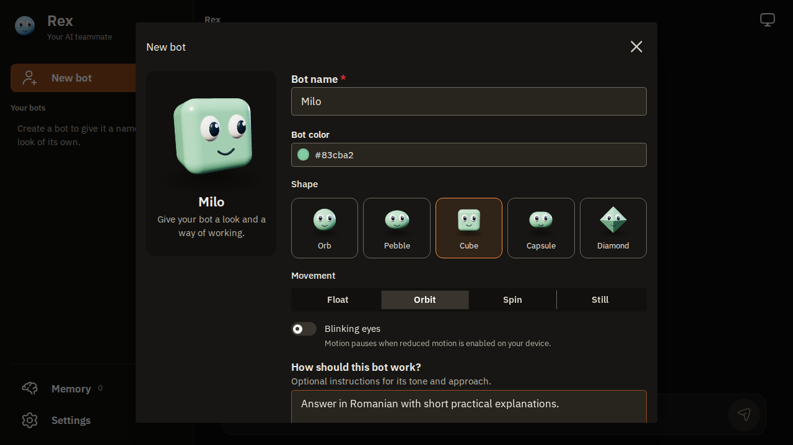

# Rexbot

Customizable AI bots with real 3D avatars, image attachments, persistent conversations, and a computer for bots: every account gets its own QEMU virtual machine, and every bot gets its own desktop on it.

Built by [RexSystems](https://github.com/rexsystems). Runs in your browser or a Tauri desktop window, with **React, Mantine, Hugeicons, Three.js, Hono, and SQLite**.



*The bot editor with a disposable demo profile. Avatars use matte 3D meshes with no gloss or cast shadows.*

## What you can do

- **Create a bot:** start with one of 100 suggested names, then choose its color, shape, movement, blinking, and working instructions. Suggestions avoid existing bot names until the pool is exhausted, then reuse the least-used names. You can always enter your own name. Edit it later without losing the conversation.
- **Give it a character:** sphere, pebble, rounded cube, capsule, or diamond geometry. Float, orbit, rotate, or stay still. Device reduced-motion preferences are respected.
- **Attach images:** paste with Ctrl+V, drag files into the conversation, or use the attachment button. Preview before sending, remove with X, and click to enlarge. Multiple images stay above your message text after reload.
- **Keep conversations:** messages, attachments, reactions, profiles, and user memories are stored in local SQLite. Bots and people can react with emoji.
- **Make groups:** use the **+** beside Groups to bring 2-6 existing bots together, or create a new bot directly from the group editor. The first member replies by default. Type `@` in the message to pick a bot, or `@everyone` to hear from all members one at a time. Arrow keys, Enter/Tab, and mouse selection work in the inline suggestions; Escape dismisses them. Edit the group later to add members or change its name.
- **Let bots collaborate:** a bot can privately contact a teammate from a shared group, including when you ask it from its own chat. The recipient uses the configured model and can verify work with tools. Inspect requests and replies under **Group settings → Private messages**. Personal chat history is not automatically forwarded.
- **Filter generic output:** every bot receives built-in guidance to finish tasks, inspect tool results, try reasonable alternatives, and apply an adapted version of antislop's 38 core rules. The source snapshot and MIT attribution live in [vendor/antislop](vendor/antislop). No runtime `npx` install is needed.
- **Use tools:** search through Tavily, fetch pages, read text/PDF attachments, and run Python or shell commands in the computer workspace.
- **Work beside the computer:** open the right-hand drawer from the conversation toolbar. Collapsing it keeps the container running and its command output available.
- **Talk live:** open the microphone button in an individual bot's chat for Gemini 3.8 Live audio, interruptions, mute, tool calls, and saved transcripts.
- **Delete deliberately:** conversation deletion asks for confirmation and plays a short squash animation after you confirm. Reduced-motion preferences skip it; deleting a group keeps its bots.

## Run locally

You need **Node.js 22.12+** and **pnpm 10.33.2**. Development is tested with Node.js 24. Podman is optional for chat and required for the computer feature.

```bash
git clone https://github.com/rexsystems/rexbot.git
cd rexbot
pnpm install --frozen-lockfile
pnpm dev
```

Open **[localhost:5173](http://localhost:5173)** for the product page, then **Open Rex** (or go to `/app`). The first visit asks you to create an account; the first account on a server is the admin and keeps any bots and chats that existed before accounts. Sign-up is closed after that until an admin opens it. In **Settings → Models**, connect a provider: OpenAI, Anthropic (native Messages API), Google Gemini, xAI, DeepSeek, OpenRouter, Mistral, Groq, a local Ollama or LM Studio, or any OpenAI-compatible server. Rex lists the provider's models live; pick one that supports streaming and function tools. Each bot can use its own model.

Create a bot with the **+** beside **Your bots**, then send it a message. Add a Tavily key in Settings if you want web search. The **+** beside **Groups** opens the group editor.

To run each process separately:

```bash
pnpm --filter @rex/shared build
pnpm dev:api
# In another terminal:
pnpm dev:web
```

The API listens on **127.0.0.1:8787** (`REX_HOST` changes the address). `.env.example` documents the available variables; the API reads a `.env` at the repository root, and exported shell variables win. Vite variables belong in `apps/web/.env.local`.

## Google AI Studio: memory and live voice

In **Settings**, add a **Google AI Studio API key** from [AI Studio](https://aistudio.google.com/apikey). This is separate from the chat provider key.

| Role | Default model |
| --- | --- |
| Text chat and private teammate replies | Your configured OpenAI-compatible chat model |
| Memory embeddings | `gemini-embedding-2` |
| Live voice | `gemini-3.8-live` |

Google documents [Gemini Embedding 2](https://ai.google.dev/gemini-api/docs/models/gemini-embedding-2) and [Gemini 3.8 Live](https://ai.google.dev/gemini-api/docs/models/gemini-3.8-live). The model fields remain editable. Chat-provider embeddings are still available through the embedding-provider selector; existing saved chat-provider configurations are preserved.

Memory embeddings use Google's native `embedContent` endpoint, one vector per text, with 768 dimensions. Vectors are tagged by provider/model so incompatible embeddings are never compared. Old memories are re-embedded lazily, up to 16 per retrieval. Missing keys or failed embedding requests fall back to keyword retrieval.

For voice, open an individual bot, click the microphone, and choose **Start call**. Allow microphone access; localhost or HTTPS is required. **Mute microphone** pauses sending audio, **End call** releases the microphone, and closing the dialog ends the call. Voice is currently one bot at a time; group conversations use text.

The local API issues a one-use Google ephemeral token, locked to the bot's setup and valid for ten minutes. The browser streams 16 kHz PCM and plays Google's PCM responses directly over the [Live WebSocket API](https://ai.google.dev/gemini-api/docs/live-api/get-started-websocket). It sends the last 20 chat messages, attachment metadata, up to eight recent memories, and the bot's profile/rules as context. Raw audio is not saved by Rexbot; transcripts and completed tool activity are saved in the bot's chat. Google receives the audio and context. Model access, quota, and billing depend on your Google account.

Live sessions may run the existing search, fetch, attachment, computer, and teammate tools. A call permits 24 tool calls and six private teammate requests; the QEMU computer starts on demand (the Podman sandbox must be started by the user). In-flight tool work may finish after a call ends and remains in the activity history. Start a new call after a connection or session expires. No system packages or Google SDK installation are required.

## Rex Computer

Rex Computer has two backends. **QEMU** (the default) gives every account its own Linux VM, run directly by QEMU on the Rex server, where every bot has its own desktop, mouse and keyboard tools, and a persistent workspace. **Podman** is an offline Python and shell sandbox. Choose with `REX_COMPUTER_BACKEND=qemu` or `REX_COMPUTER_BACKEND=podman`.

### QEMU desktop

```bash
scripts/qemu/setup-host.sh       # QEMU, qemu-img, cloud-image-utils, ssh; checks /dev/kvm
pnpm --filter api build-image     # or open the computer panel → Build image
```

The image build downloads the Debian 13 cloud image, installs the desktop once, and stores it as a template. Each account's VM is a copy-on-write overlay of that template, created in seconds on first use. How it works, settings, and the security model: [docs/qemu-computer.md](docs/qemu-computer.md).

- Every bot gets its own 1280×800 screen (Openbox and a taskbar) on its owner's VM. The computer panel shows the current bot's screen; in a group, pick a member's screen.
- Bots get `computer_exec` (bash as `rex` in `/workspace/bots/<bot>`, with `DISPLAY` and passwordless sudo), `computer_input` (mouse and keyboard), project/file tools, and `computer_screenshot`. Vision-enabled model connections receive screenshot pixels for inspection; other models get metadata and can share the image with the owner.
- While a bot uses the mouse or keyboard, its screen is view-only for you. It unlocks after a minute of inactivity, or when you press **Take control**.
- Files in `/workspace` survive restarts. `/workspace/shared` is visible to all of the account's bots as `./shared`.
- VMs start when a bot needs them and keep running across API restarts. An admin can enable idle shutdown.
- The screen streams through the Rex API over SSH; noVNC only listens on the VM's localhost.

The VM can reach public websites through a filtered proxy. Direct host/private-network traffic is blocked outside the guest. An account's bots run as the same Linux user, so they can read each other's folders. Accounts never share a VM.

### Podman sandbox

Install local **rootless Podman** with seccomp and cgroup v2. On Fedora or Nobara:

```bash
sudo dnf install podman
podman info
podman pull docker.io/library/python:3.13-alpine
```

Use the **computer icon at the top right of the conversation**, then choose **Start computer**. Run a command in the drawer, or ask your bot to use its computer in chat.

| Resource | Limit |
| --- | --- |
| Environment | Python 3 and Alpine shell |
| CPU | 1 core |
| Memory | 512 MB, no extra swap |
| Processes | 64 |
| Workspace | 128 MB in temporary memory |
| Temporary directory | 32 MB |
| Command duration | 20 seconds |
| Command output | 32,000 characters |
| Session lifetime | 1 hour |

The container runs as a non-root user with all capabilities dropped, no new privileges, a read-only operating system, **no network**, no host directory mounts, and no container-engine socket. A timed-out command removes the entire container, including child processes. **Stop & erase workspace** deletes its temporary files.

Each account has its own Podman computer. Hiding the drawer does not stop it. Containers share the host kernel and are not virtual machines. This is a Python/shell workspace without a desktop; use the QEMU backend for screens.

## Images and attachments

Attach up to **8 files per message**, **8 MB each**. PNG, JPEG, WebP, GIF, and AVIF have inline previews. Click a thumbnail to view it at a larger size; use Previous/Next or the arrow keys to browse a group, and Escape to close it. Images can be sent with or without text.

Uploads appear immediately in the composer while transferring. Send stays disabled until they finish. Failed uploads can be retried or removed, and removing an unsent file cleans up its upload. Sent attachments are associated with their message and reload with it.

Image display is independent of the model. Connections with image support enabled send recent supported attachments and guest screenshots to vision-capable models through the OpenAI-compatible or native Anthropic adapter. PNG, JPEG and WebP are supported for inspection, up to 5 MB each, with at most four recent images per model request. Other connections keep text/metadata input and must not claim to see pixels.

## Desktop

Install Rust and the [Tauri prerequisites for your platform](https://v2.tauri.app/start/prerequisites/), then start the desktop app:

```bash
pnpm dev:desktop
```

Enter your Rex website's HTTPS address, then sign in or create an account if registration is open. The desktop app remembers the address and opens the website without native shell or filesystem permissions. It does not need a local API. The computer backends run in isolated guests on the website's API host. Connection, deployment and security details: [docs/desktop.md](docs/desktop.md).

## Development

| Directory | Responsibility |
| --- | --- |
| `apps/web` | React, Mantine, Hugeicons, image composer, shared Three.js avatar renderer |
| `apps/api` | Hono API, streaming model tools, SQLite, file storage, QEMU and Podman computers |
| `apps/desktop` | Tauri desktop shell |
| `packages/shared` | Types, bot profiles, tool definitions, and system prompt |
| `scripts/guest`, `scripts/qemu` | Guest desktop setup (`rex-sessiond`) and QEMU host setup |
| `docs` | QEMU computer guide, UI validation, screenshots |

```bash
pnpm build
pnpm typecheck
pnpm --filter web exec playwright install chromium
pnpm test
```

The complete test suite needs the Podman image above. API tests use disposable databases and containers. Browser tests start a separate API and web server, use a mock model instead of a paid API key, and exercise real uploads, clipboard image paste, drag & drop, image previews, profile persistence, 3D rendering, reactions, groups, private messaging, and responsive layouts. Google checks simulate the provider responses while exercising real browser microphone capture, AudioWorklet PCM conversion, WebSocket messages, playback, tool callbacks, transcripts, and cleanup. They also cover embedding-provider migration and deletion confirmation, failure recovery, animation, and reduced motion. These checks do not make a paid Google request or measure live speech quality.

Avatar meshes share **one WebGL renderer**. Animated visible characters follow the screen's animation frames; stationary characters redraw only when their appearance changes or they blink. Hidden characters and tabs skip rendering. The Three.js module loads separately from the main interface. No external model or texture downloads are required. See the [UI validation notes](docs/ui-validation.md) for the checks and implementation choices.

## Data and access

- SQLite and uploads live in `data/` by default, or the directory specified with `REX_DATA_DIR`.
- Provider keys are stored per account on the server, encrypted with AES-256-GCM (`REX_SECRET_KEY` or a generated `secret.key` in the data directory); the API returns only the last four characters. The older browser-stored key still works as a fallback. Members can only connect providers on public addresses; admins may use local ones. Chat text, selected memories, and tool results are sent to your configured model provider.
- The Google key is sent to the local API for embeddings and ephemeral-token issuance; the live WebSocket uses only the short-lived token. Live settings stay in API memory for the session and any in-flight tool work. Google receives memory text for embeddings and microphone audio/context during voice calls.
- Group history and private exchanges use the same configured provider. A private recipient receives its profile, the passed task, and up to six recent exchanges with that teammate in the shared group, rather than either bot's personal conversation history. Private exchanges are persisted locally and inspectable by the owner; "private" means outside the shared conversation, not hidden from the owner or model provider.
- Every account has its own bots, groups, chats, memory, uploads, and computer; the API checks ownership on every request. Passwords are stored as scrypt hashes, sessions as SHA-256 hashes of a random token in an HttpOnly cookie. Admins manage accounts but do not read other people's chats.
- Bots' `http_fetch` refuses loopback, private, link-local, and metadata addresses, including after redirects. The VM's public-site proxy enforces the same boundary outside the guest.
- The API binds to loopback and restricts browser origins. To host it for others, put it behind an HTTPS reverse proxy and set `REX_WEB_ORIGIN`.
- Keys, user data, uploads, build outputs, and local agent configuration are excluded from the repository.

## Current scope

Rexbot provides chat, customizable bots, groups, private collaboration, Google live voice and memory embeddings, attachments, scheduled routines, and isolated computer workspaces. Group messages get one public reply by default, from the first member or the first bot explicitly mentioned. `@everyone` gives each member one turn in group order. Requests in the same conversation cannot overlap. Each responding bot can use up to sixteen tool rounds and four calls per round. A user turn permits at most six private requests total. Private recipients can use up to three tool rounds and cannot delegate recursively. Prompts guide behavior, while capability and answer quality depend on the configured model and available tools.

The text adapter preserves a provider's streamed `reasoning_content` through tool rounds and keeps model-scoped reasoning metadata for later turns. This supports [DeepSeek thinking-mode tool calls](https://api-docs.deepseek.com/guides/thinking_mode/). Metadata stays in local SQLite and is not part of visible chat messages or public conversation/private-exchange API responses. Reasoning from another provider/model is not forwarded. Speaker names are rendered by the interface; replies do not need to repeat `[Bot name]:` in their text.

Scheduled routines are available through the Routines panel and the bot's routine tool. Bots can schedule useful follow-up for ongoing tasks, avoid duplicates, and report the schedule. The API must stay running and the account needs a server-saved model connection. Bots can ask focused clarification questions in a persisted chat card; the answer dialog accepts options or custom text and resumes the same conversation. See `PROGRESS.md` for remaining work.

## License

Rexbot is licensed under the **GNU Affero General Public License v3.0 only** (`AGPL-3.0-only`). See [LICENSE](LICENSE) for the full text.

The bundled antislop source snapshot and adapted rules retain their upstream [MIT attribution](vendor/antislop/LICENSE).
